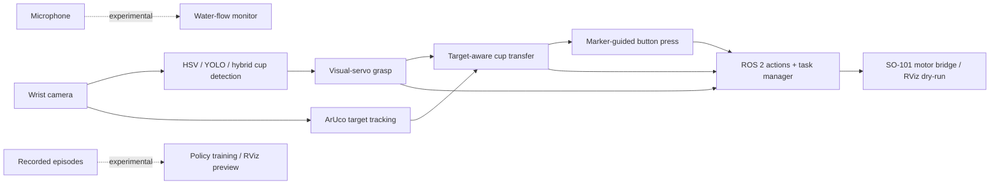

# Ninibot

<p align="center">
  <strong>A ROS 2 research prototype for vision-guided cup grasping, ArUco-guided placement, and button pressing with an SO-101 arm.</strong>
</p>

<p align="center">
  
  
  
</p>

<!--
Add the portfolio hero after shooting it:

See docs/MEDIA_PLAN.md for the exact shot and export settings.
-->

Ninibot combines camera-based perception, cylindrical inverse kinematics,
state-machine skills, ROS 2 actions, and teach/replay trajectory tooling. The
current end-to-end demo scans for a destination, finds and grasps a cup, moves
it to the target, and presses a marked button.

> **Project status:** active research prototype. Geometry, camera calibration,
> colors, and motion limits are tuned for one physical workcell. Start in
> `dry_run:=True`, verify the model in RViz, and recalibrate before enabling
> motors.

## Quick demo

<!--
After recording the short demo, add:
[](FULL_DEMO_URL)
-->

The planned demo video and exact capture checklist are in
[docs/MEDIA_PLAN.md](docs/MEDIA_PLAN.md). Until the physical media is added,
the architecture and trajectory-processing result below document the system.

## Current status

| Capability | Status |
| --- | --- |
| Cup search, visual alignment, and grasp state machine | Implemented |
| ArUco target scan and cup-transfer flow | Implemented |
| ArUco + IK button-press flow | Implemented |
| RViz dry-run and hardware diagnostics | Implemented |
| Teach, smooth, retarget, and preview trajectories | Implemented; one processed sample included |
| HSV, YOLO, and hybrid detector backends | Implemented; no accuracy benchmark is claimed |
| Structured imitation policy | Experimental offline baseline / RViz preview |
| Audio water-flow detection | Experimental standalone subsystem; not connected to the full demo |

## System architecture



The main workflow is deliberately split into observable skills. Each skill
publishes status, can be launched independently, and can be exercised against
RViz before a real-arm run.

## Implementation highlights

| Area | Implementation |
| --- | --- |
| Perception | HSV cup segmentation, YOLO cup detection, hybrid YOLO-gated HSV centering, ArUco pose estimation |
| Manipulation | Search, approach, fine alignment, grasp, lift, carry, release, and button-press state machines |
| Motion | Cylindrical arm model, numerical grippertip IK, joint ramps, limits, and SO-101 motor bridge |
| Orchestration | ROS 2 action servers and an end-to-end task manager with feedback and failure states |
| Learning tools | Episode logging, teach/replay trajectory processing, structured-policy training and preview |
| Developer workflow | Dry-run mode, RViz configurations, calibration utilities, and focused unit tests |

## Repository map

```text
src/
  arm_controller/       Kinematics, URDF, RViz, and SO-101 motor bridge
  vision_controller/    Cup and ArUco perception
  audio_controller/     Experimental water-flow audio monitoring
  ninibot_interfaces/   ROS 2 actions and IK service
  ninibot/              Skills, orchestration, policies, launch, and config
tools/
  calibration/          Camera, marker, arm, and button-pose utilities
  debug/                Small hardware/perception diagnostic programs
  ml/                   Structured-policy training and evaluation
data/
  calibration/          Public example; create your local calibrated file here
  trajectories/         One processed teach/replay trajectory example
docs/                   Bring-up, calibration, demo, learning, and media guides
```

The private working repository also contains raw recordings, experiments,
model artifacts, and historical snapshots. Those are intentionally excluded
from this public portfolio repository.

## Reference setup

- Ubuntu 24.04 with ROS 2 Jazzy
- SO-101 arm with Feetech servos
- USB wrist camera
- Printed ArUco markers for the placement target and button
- Optional microphone for the standalone water-flow experiment

The motor bridge uses APIs from
[Hugging Face LeRobot](https://github.com/huggingface/lerobot). Install and
calibrate the LeRobot SO-101 stack for your hardware before a real-arm run.
YOLO and audio support are optional; HSV perception and RViz dry-run do not
require either feature.

## Build

```bash
git clone https://github.com/mren2222/ninibot.git
cd ninibot

source /opt/ros/jazzy/setup.bash
rosdep install --from-paths src --ignore-src -r -y
colcon build --symlink-install
source install/setup.bash
```

Create a machine-local calibration file:

```bash
cp data/calibration/camera_calibration.example.yaml \
   data/calibration/camera_calibration.yaml
```

The example only documents the expected format. Run the procedures in
[docs/calibration.md](docs/calibration.md) before relying on metric camera
poses.

## First launch: RViz / dry-run

Connect a camera, then run the grasp-and-move chain without commanding motors:

```bash
ros2 launch ninibot grasp_and_move_cup_demo.launch.py \
  dry_run:=True \
  detector_backend:=hsv \
  camera_device:="" \
  camera_index:=0
```

Use Ctrl+C to stop. Confirm camera orientation, TF frames, joint limits, and all
planned poses before changing `dry_run` to `False`.

## Real-hardware demo

After calibrating the arm and camera, checking the workspace, and confirming the
serial port:

```bash
ros2 launch ninibot full_demo.launch.py \
  dry_run:=False \
  detector_backend:=hsv \
  port:=/dev/ttyACM0 \
  camera_device:="" \
  camera_index:=0
```

The public defaults use HSV so the demo does not depend on a private model
file. To use YOLO or hybrid detection, install Ultralytics and provide your own
model:

```bash
ros2 launch ninibot full_demo.launch.py \
  detector_backend:=hybrid \
  yolo_model_path:=/absolute/path/to/model.pt
```

See [docs/demo.md](docs/demo.md) for individual skill launches and status
topics, and [docs/bringup.md](docs/bringup.md) for the full checklist.

## Trajectory teaching

The repository includes a small processed trajectory example rather than raw
operator recordings. This plot illustrates the smoothing and retargeting
pipeline; it is not a safety or performance benchmark.


The companion joint-dynamics diagnostic remains in the same sample directory
for detailed inspection.

## Tests

After building and sourcing the workspace:

```bash
python3 -m pytest src/ninibot/test -q
```

The tests focus on geometry, planners, controller transitions, target locking,
and failure/recovery behavior. Hardware-in-the-loop validation is still
required for real-arm changes.

## Portfolio media

[docs/MEDIA_PLAN.md](docs/MEDIA_PLAN.md) is a prioritized shot list with exact
filenames, README placement, framing, duration, and export guidance. The first
three additions should be:

1. `media/hero-workcell.jpg` — one clean 16:9 view of the complete workcell.
2. `media/demo-preview.gif` — an 8–12 second grasp → move → press highlight.
3. A 45–90 second full demo hosted on YouTube or a GitHub Release and linked
   from “Quick demo.”

## Limitations

- The current parameters are workcell-specific and require calibration.
- No detector accuracy, task success-rate, or cross-environment benchmark is
  included yet.
- The main demo is rule/state-machine based; the learned policy is a separate
  experimental preview path.
- Water-flow audio detection is not yet part of the end-to-end task manager.
- RViz dry-run does not provide collision guarantees.

## Safety

This software can command physical motors. Keep an emergency stop within reach,
start with conservative speed/torque limits, keep people and fragile objects
outside the arm envelope, and never treat RViz success as proof of collision
safety.

## License and attribution

Project code is released under the [Apache License 2.0](LICENSE). See
[THIRD_PARTY_NOTICES.md](THIRD_PARTY_NOTICES.md) for SO-101 CAD/mesh and
LeRobot attribution.

