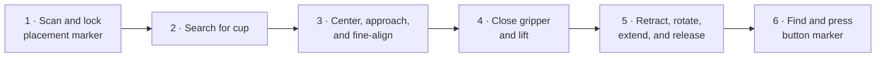
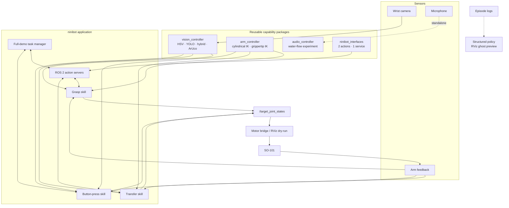
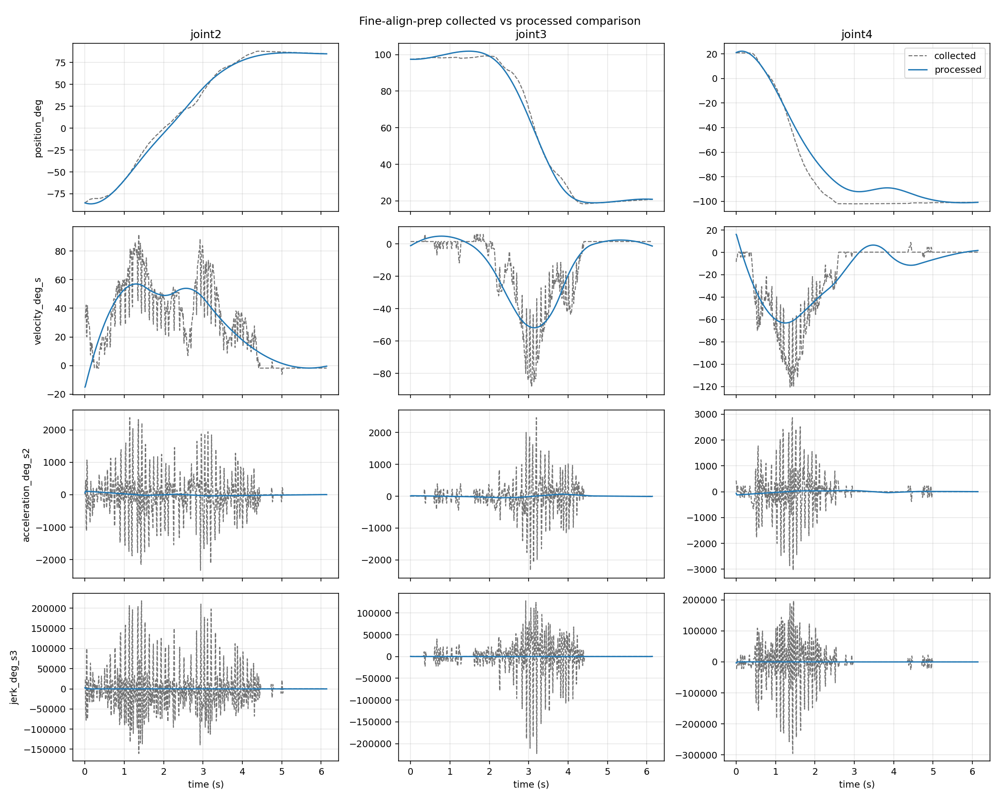

# Ninibot

<p align="center">
  <strong>A full-stack ROS 2 manipulation project: perceive a cup, acquire it with visual feedback, transfer it to a marker-defined target, and press a second marked target with a low-cost SO-101 arm.</strong>
</p>

<p align="center">
  
  
  
  
</p>

Ninibot is a vision-guided tabletop manipulation system I designed and
implemented around an SO-101 arm. It locks a destination marker, searches for
and aligns with a cup, transfers the cup through a staged motion plan, then
aligns with and presses a marked button.

**[Part 1 · Project highlights](#part-1-project-highlights)** ·
**[Part 2 · Technical walkthrough](#part-2-technical-walkthrough)**

## Part 1: Project highlights

### Demo videos

Click a thumbnail or title to watch on YouTube.

| Demo 1 · YouTube Shorts | Demo 2 · YouTube |
| :---: | :---: |
| [](https://www.youtube.com/shorts/3JaoesLpO_s) | [](https://youtu.be/n-ShdZxDUmQ) |
| [▶ Watch demo 1](https://www.youtube.com/shorts/3JaoesLpO_s) | [▶ Watch demo 2](https://youtu.be/n-ShdZxDUmQ) |

### Project at a glance

| | |
| --- | --- |
| **My work** | System architecture, perception integration, kinematics and motion logic, manipulation state machines, ROS 2 orchestration, hardware tooling, tests, and experimental learning pipelines |
| **Core stack** | Python, ROS 2 Jazzy, OpenCV, ArUco, NumPy, PyTorch, Ultralytics YOLO, RViz, Feetech / LeRobot SO-101 |
| **Implemented scope** | Destination scan, cup search and visual alignment, grasp, staged transfer and release, marker-guided button press, dry-run visualization, and diagnostic tooling |
| **Repository evidence** | 5 ROS 2 packages · 3 selectable cup-perception backends · 2 actions + 1 IK service · 25 focused test modules containing 112 test functions |
| **Status** | Active research prototype tuned for one tabletop workcell; the production demo is rule/state-machine based |

### Key contributions

#### 1. Automated demonstration collection with physical scene reset

I built a repeatable collection loop for imitation learning: the rule-based
visual controller generates fine-alignment demonstrations, the robot picks up
and randomly repositions the cup, and the next episode starts after reset and
settling. Normal collection cycles do not require someone to reposition the cup
between episodes. Sampled placement targets are checked for reachability.

[Collection orchestrator](src/ninibot/ninibot/orchestration/fine_align_episode_collector.py) ·
[Random placement](src/ninibot/ninibot/skills/random_place_cup_node.py) ·
[Learning pipeline](#automated-data-collection)

#### 2. Hand-guided teaching becomes a reusable motion template

For the transition from the search pose to fine alignment, I record a
hand-guided movement with motor torque disabled, then resample and smooth its
shape, preserve its endpoints, and reconstruct wrist orientation. The resulting
template adapts to the current starting pose and is used by the manipulation
pipeline. This makes a complex transition easier to author and refine.

[Teaching recorder](src/ninibot/ninibot/trajectories/record_prep_trajectory.py) ·
[Trajectory processing](src/ninibot/ninibot/trajectories/prep_trajectory.py) ·
[Recorded case study](#a-trajectory-teaching-case-study)

#### 3. Camera calibration and coordinate transforms connect vision to motion

I implemented checkerboard-based intrinsic calibration with reprojection-error
reporting, modeled the camera mounting and optical frames in the robot URDF,
and used TF to transform camera observations into the robot base frame.
ArUco geometry tools inspect target positions and frame axes so calibration
and manipulation can be debugged together.

[Calibration tools](tools/calibration/calibrate_camera.py) ·
[TF conversion](src/vision_controller/vision_controller/aruco_tf.py) ·
[Geometry details](#camera-calibration-and-coordinate-frames)

#### 4. Hybrid perception separates object identity from control localization

YOLO identifies the cup region; HSV supplies the centroid used for visual
feedback. Candidate gating, temporal continuity, reuse of the previous region
of interest, and task-dependent fallbacks address ambiguous detections and
short tracking losses. HSV, YOLO, and hybrid backends share the same grasp
controller, making their behavior comparable within one system.

[Hybrid detector](src/vision_controller/vision_controller/hybrid_detector.py) ·
[Perception design](#2-perception-backends-express-different-trade-offs)

#### 5. Closed-loop skills handle uncertainty throughout the task

Image errors drive repeated alignment corrections. Multi-frame settling,
hysteresis, and detection-loss recovery control when the robot advances or
searches again. The destination is statistically locked before grasping, while
button pressing uses marker geometry and bounded IK corrections. These choices
make the task's decisions and failure states observable.

[Grasp state machine](src/ninibot/ninibot/skills/grasp_cup/controller.py) ·
[Controller details](#controller-and-motion-design)

#### 6. Motion planning accounts for the tabletop workspace

Transfer motion follows lift → retract → rotate → extend → lower, reducing
the end-effector's rotation radius before the arm turns. Taught transitions
provide another way to author a compact motion shape, with smoothing and
retargeting preparing it for execution. Space savings from the taught path
remain to be quantified; smoothing alone does not establish a smaller sweep.

[Carry planner](src/ninibot/ninibot/skills/move_cup/carry_planner.py) ·
[Motion design](#4-transfer-is-planned-in-robot-centered-cylindrical-space)

#### 7. A complete ROS 2 system with testable components

I integrated perception, kinematics, skills, ROS 2 actions, motor execution,
calibration tools, and learning experiments across five packages. Core decision
logic is separated from ROS I/O for focused testing, and RViz previews and
individual skill launches support diagnosis before a full hardware run.

[Architecture](#system-architecture) ·
[Tests and validation](#evidence-and-validation) ·
[Repository guide](#explore-the-repository)

The main hardware demo uses rule-based control. Imitation learning currently
covers automated demonstration collection, offline training/evaluation, and
RViz policy preview.

---

## Part 2: Technical walkthrough

[Task flow](#what-the-robot-does) ·
[Calibration and TF](#camera-calibration-and-coordinate-frames) ·
[Controllers and motion](#controller-and-motion-design) ·
[Architecture](#system-architecture) ·
[Trajectory case study](#a-trajectory-teaching-case-study) ·
[Validation](#evidence-and-validation) ·
[Learning experiments](#controlled-experiments-beyond-the-main-demo) ·
[Setup and documentation](#explore-the-repository)

The goal was not to produce one scripted demo. I built the project as a set of
observable and testable subsystems: interchangeable perception backends,
feedback-driven skill state machines, cylindrical and URDF-based kinematics,
ROS 2 actions, a rate-limited motor bridge, calibration and diagnostic tools,
and isolated learning experiments.

The central challenge is uncertainty at every boundary. Camera detections
jitter or disappear, marker poses vary between frames, rotating an extended
arm creates a large sweep, and learned outputs should not bypass geometric
constraints. Ninibot addresses those problems with multi-frame target locks,
hysteresis and recovery behavior, retract-before-rotate transfer motion,
bounded incremental IK, explicit failure states, and RViz-first validation.

### What the robot does



The order is deliberate. The full demo finds and statistically locks the
placement target **before** grasping the cup, so the arm does not need to search
the scene while carrying an object. Each major step publishes status and can be
run independently during debugging.

### The engineering problem

A reliable tabletop demo needs more than object detection and a list of joint
poses:

- The wrist camera sees a moving target, so a single detection is not a stable
  command.
- Cup location is naturally described by image error and radial distance, while
  the motor layer expects joint angles.
- ArUco pose estimates must be transformed into the robot base frame and
  filtered before they become manipulation targets.
- Transfer motion must respect reach and joint limits while reducing the arm's
  swept radius.
- A taught trajectory should preserve the useful shape of the demonstration
  without being tied to its original endpoints.
- Experimental learned control needs a safe observation path before it can be
  considered for hardware.

The project therefore separates perception, decision logic, geometry, ROS I/O,
and motor execution rather than hiding them in one monolithic node.

### Camera calibration and coordinate frames

Metric manipulation depends on both camera calibration and a consistent
transform chain:

```text
robot base → arm joints → grippertip → camera → camera_optical_frame
```

The intrinsic-calibration tool detects checkerboard corners across multiple
views, solves for the camera matrix and distortion coefficients, reports RMS
and per-image reprojection errors, and writes a ROS-compatible calibration
file. The physical checkerboard and marker dimensions are specified in metres.

The URDF defines the fixed camera mounting relative to the gripper tip and a
separate optical frame. The robot state publisher uses joint feedback to
provide the moving transform chain; TF converts ArUco observations from the
camera optical frame into base-frame positions used by manipulation.

The extrinsic-check tool displays camera axes and marker/gripper positions in
the base frame, and summarizes repeated observations. Camera mounting
extrinsics are configured in the URDF and checked with these tools; the
repository does not include an automatic hand-eye calibration solver.
Measurement accuracy still depends on the physical calibration and workcell.

[Intrinsic calibration](tools/calibration/calibrate_camera.py) ·
[Robot and camera frames](src/arm_controller/urdf/so101.urdf) ·
[Extrinsic checks](tools/calibration/check_aruco_extrinsics.py) ·
[Setup instructions](docs/calibration.md)

### Controller and motion design

#### 1. Detection became a closed-loop acquisition process

The grasp controller progresses through explicit phases:

```text
SEARCH_PREP → SEARCHING → TRACKING_CENTER
            → FINE_ALIGN_PREP → FINE_ALIGN → FINISHED
```

Horizontal image error steers the base. Apparent cup width acts as a practical
approach-distance proxy and adjusts cylindrical radius. Detection centers are
smoothed, multiple centered cycles are required before advancing, and separate
acquire/release tolerances prevent the approach lock from chattering near a
threshold.

A brief detection loss holds the previous target for a configurable grace
period (1.5 seconds in the public defaults). A longer loss returns the
controller to search. The transition logic lives in a pure, dataclass-based
controller, which makes recovery behavior testable without a camera or arm.

#### 2. Perception backends express different trade-offs

The same grasp state machine can use three backends:

| Backend | Role |
| --- | --- |
| **HSV** | Lightweight, model-free baseline for a controlled workcell |
| **YOLO** | Semantic cup selection with user-supplied weights |
| **Hybrid** | YOLO supplies the semantic region; HSV supplies the control centroid |

Hybrid mode is more than running both detectors independently. It gates HSV
candidates by overlap and normalized center distance, ranks YOLO candidates
using confidence and track continuity, reuses the recent region of interest
across short misses, and enables state-dependent full-frame fallbacks. This
separates “which object is the cup?” from “where is the most stable point for
feedback control?” without claiming an unmeasured accuracy improvement.

#### 3. The destination is locked before the scene changes

The placement marker is observed in the camera frame, transformed into the
robot base frame, and sampled repeatedly. Public defaults require five samples;
the lock is rejected while the largest positional standard deviation exceeds
1 cm. The accepted target is the sample mean, then checked against reach and
joint constraints.

This solves an orchestration problem as well as a perception problem: the
transfer stage receives a fixed target before the gripper changes the scene.
If the marker disappears during sample collection, the lock is discarded and
the scan resumes.

#### 4. Transfer is planned in robot-centered cylindrical space

Cup motion is represented as `(theta, radius, z)`, which aligns naturally with
the tabletop task:

```text
GRIPPING → LIFTING → RETRACTING_RADIUS → MOVING_TO_TARGET
         → EXTENDING_RADIUS → LOWERING_TO_RELEASE → RELEASING
         → POST_RELEASE_CLEARANCE → RETURNING_SEARCH_PREP
```

The arm lifts first, retracts before base rotation, and only then extends toward
the destination. Retraction reduces the swept radius compared with rotating at
full reach. The planner maintains a carry height, applies reach margins,
clamps targets to configured limits, solves cylindrical IK, and creates a
post-release clearance motion before returning to search.

Minimum-jerk profiles are used for staged transitions, while the motor layer
adds per-joint velocity and acceleration limiting with braking-distance and
overshoot checks.

#### 5. Button pressing is solved from marker geometry, not memorized joints

The button target comes from an ArUco pose plus a calibrated marker-relative
offset. Camera observations are transformed to the base frame and compared
with the live grippertip transform. Fine alignment then repeats a
sample → solve → bounded move cycle.

The public configuration limits Cartesian correction steps to 6 mm. A
URDF-derived numerical IK solver enforces joint bounds, residual tolerance, and
maximum joint change; the ROS service path also has an internal-solver
fallback. Once aligned, explicit press, lift, repeat, timeout, and failure
phases keep the behavior inspectable.

#### 6. Kinesthetic teaching produces a retargetable motion, not a recording

For the transition from a head-down search pose to fine alignment, I wanted to
preserve the useful shape of a hand-guided movement without hard-coding its
original endpoints. The processing pipeline decomposes a recorded motion into
an endpoint baseline and a nonlinear residual:

```text
delta_shape(t) = taught_q(t) - linear_interpolate(taught_start, taught_end)

runtime_q2/3(t) = interpolate(current_start, desired_end) + delta_shape(t)
```

The residual is spline-smoothed, with extra weight on sustained low-speed
regions so useful plateaus are not turned into small reverse motions. Residual
endpoints are forced to zero, which guarantees that retargeting still reaches
the requested start and end.

Joint 4 is reconstructed from the current shoulder/elbow geometry rather than
replaying a noisy wrist trace:

```text
joint4(t) = horizontal_wrist(joint2, joint3)
            + start_offset · (1 - smootherstep(t))
```

This keeps the wrist orientation meaningful after joints 2 and 3 are
retargeted.

### System architecture



The package dependency direction is intentional: controller, perception,
audio, and message packages do not depend on the top-level application.
`ninibot` composes them into skills and demos. Status topics and action feedback
flow back to the task manager, so progress and failure are visible rather than
buried inside a single process.

| Package | Responsibility |
| --- | --- |
| `arm_controller` | SO-101 model, cylindrical and numerical IK, motor bridge, joint-state plumbing, RViz |
| `vision_controller` | HSV, YOLO, hybrid cup detection, ArUco helpers, camera/base transforms |
| `audio_controller` | Standalone adaptive water-flow experiment |
| `ninibot_interfaces` | `GraspCup`, `MoveCup`, and `SolveGrippertipIk` contracts |
| `ninibot` | Skills, actions, orchestration, trajectory tooling, logging, policies, launch, and configuration |

### A trajectory-teaching case study

The public repository includes one processed `FINE_ALIGN_PREP` artifact so the
motion-development workflow can be inspected without publishing raw operator
recordings.

| Artifact fact | Value |
| --- | --- |
| Raw recording duration | 19.14 s |
| Trimmed and processed duration | 6.14 s |
| Processed samples | 616 at 100 Hz |
| Processing | Weighted spline residual + horizontal-wrist reconstruction |
| Configured endpoint adjustment | +1 cm radius, +2 cm height |
| Diagnostics | Position, velocity, acceleration, jerk, and raw/processed comparison |



The companion
[joint-dynamics plot](data/trajectories/fine_align_prep/sessions/2026-06-15_8cm_base_raw/processed_joint_dynamics.png)
shows the derivatives used to inspect the processed motion. This is a
traceable engineering artifact, not a task-performance or safety benchmark.

### Evidence and validation

The repository contains 25 focused test modules with 112 test functions. They
cover geometry, controller transitions, target locking, search recovery, carry
planning, marker tracking, IK behavior, joint ramps, and press motion. Much of
the decision logic is isolated from ROS I/O so it can be tested as deterministic
Python.

Validation is layered:

1. Pure controller and planner tests exercise transitions, limits, and failure
   behavior.
2. Component tools inspect HSV/YOLO detection, ArUco geometry, transforms,
   camera intrinsics, grippertip pose, and motor state.
3. RViz dry-run keeps target, real, and experimental policy joint streams
   separate.
4. Individual grasp, transfer, and button-press launches isolate one subsystem
   before the full task manager is enabled.
5. Physical runs remain supervised and workcell-specific.

To run the focused tests after building and sourcing the workspace:

```bash
python3 -m pytest src/ninibot/test -q
```

### Controlled experiments beyond the main demo

#### Structured imitation learning

The episode logger records joint feedback, target joints, vision errors, skill
states, action deltas, metadata, and optional images. The experimental
fine-alignment policy predicts small `Δtheta` and `Δradius` corrections rather
than raw joint commands. Those deltas still pass through cylindrical IK and
joint constraints.

Policy output is published as a separate `/policy_joint_states` ghost in RViz.
It is intentionally not the controller used by the main hardware demo. This
keeps learning inside the existing geometric envelope and creates an
observation step before hardware integration.

#### Automated data collection

The collection launch connects the rule-based visual controller, episode
logger, collection orchestrator, and random-placement skill into a repeatable
cycle:

```text
Search and visually fine-align → finish/save episode
    → grip cup → move to a sampled placement → release and return
    → wait for settling → start the next episode
```

The demonstrator is the closed-loop rule-based controller. The logger samples
the latest vision errors, real/target joints, task states, and action deltas,
with metadata and optional images. The placement skill samples a new tabletop
location and checks angular/radial bounds and IK reachability before executing
the reset. Normal successful cycles therefore do not need manual cup placement
between episodes.

The orchestrator supports episode limits, pause/resume, reset timeouts, and
configurable behavior after failures. Physical collection remains supervised;
automatic reset does not imply recovery from every hardware or scene failure.

These demonstrations train a structured imitation policy offline. The training
script splits data by episode to keep samples from the same episode out of both
training and validation sets. Dataset batches remain separate so controller
changes and collection runs stay traceable. Policy deployment and online
retraining are not part of this collection loop.

[Collection launch](src/ninibot/launch/learning/collect_fine_align_episodes.launch.py) ·
[Episode logger](src/ninibot/ninibot/logging/episode_logger.py) ·
[Offline training](tools/ml/train_structured_policy.py)

#### Audio water-flow sensing

The standalone audio subsystem combines RMS and 800–6000 Hz band energy,
learns a median ambient baseline, then applies distinct start/stop thresholds
and minimum dwell times. The result behaves like a debounced hysteresis
detector rather than a single amplitude threshold. It is an experimental
extension and is not connected to the full task manager.

### Selected design decisions and trade-offs

| Problem | Decision | Why / trade-off |
| --- | --- | --- |
| Noisy or intermittent cup detections | Multi-frame settling, hysteresis, smoothing, and a lost-target grace period | More state than a one-frame controller, but transitions are observable and testable |
| Semantic detection is not always the best control centroid | Split semantic gating (YOLO) from geometric centering (HSV) | Preserves a model-free default; no unmeasured accuracy claim |
| Marker poses jitter | Require a stable multi-sample target lock | Adds scan time, but prevents a noisy frame from defining the whole transfer |
| Rotation at full reach creates a large sweep | Lift, retract, rotate, extend, lower | Longer sequence, but smaller swept radius and clearer reach checks |
| Raw joint replay is tied to one demonstration | Baseline + endpoint-constrained residual retargeting | Requires processing, but preserves motion shape across new endpoints |
| Learned actions may violate robot geometry | Predict small cylindrical deltas and retain IK/limits | Less end-to-end, but easier to inspect and constrain |
| Hardware makes iteration expensive | Dry-run by default with independent skills and diagnostic streams | RViz is not collision proof, but catches integration errors before motor enable |

### Limitations and next steps

Ninibot is an active research prototype, not a general-purpose manipulation
stack.

- Geometry, colors, camera transforms, and motion limits are tuned for one
  physical workcell.
- The repository does not claim detector accuracy, task success rate,
  cross-workcell generalization, or collision avoidance.
- The main demo is rule/state-machine based; the learned policy remains an
  offline/RViz experiment.
- Audio water-flow detection is not yet connected to end-to-end orchestration.
- RViz dry-run does not guarantee collision-free or safe physical motion.

The most useful next steps are to measure repeated grasp/transfer/press success,
add collision-aware planning and hardware-in-the-loop regression tests,
validate across lighting and object changes, compare rule-based and learned
fine alignment quantitatively, and connect water-flow feedback only after
workcell-level validation.

### Explore the repository

```text
src/
  arm_controller/       Robot model, kinematics, SO-101 bridge, and RViz
  vision_controller/    Cup and ArUco perception
  audio_controller/     Experimental water-flow sensing
  ninibot_interfaces/   ROS 2 actions and IK service
  ninibot/              Skills, orchestration, trajectories, and learning tools
tools/
  calibration/          Camera, marker, arm, and button-pose utilities
  debug/                Focused perception and hardware diagnostics
  ml/                   Structured-policy training and evaluation
data/
  calibration/          Public schema example for machine-local calibration
  trajectories/         Processed teach/retarget example and diagnostics
docs/                   Architecture, operation, learning, and media guides
```

| Documentation | Purpose |
| --- | --- |
| [Software architecture](docs/structure.md) | Package boundaries, dependency direction, and runtime data flow |
| [Demo operation](docs/demo.md) | Full demo, detector choices, skill launches, and monitoring |
| [System bring-up](docs/bringup.md) | Dry-run-first setup, camera, serial port, and key topics |
| [Calibration and diagnostics](docs/calibration.md) | Intrinsics, marker geometry, motor calibration, and smoke tests |
| [Learning and taught trajectories](docs/learning.md) | Episode collection, structured policy, kinesthetic processing, and RViz preview |
| [Portfolio media guide](docs/MEDIA_PLAN.md) | Prioritized photo/video shot list and exact asset locations |

<details>
<summary><strong>Build and start the public dry-run</strong></summary>

Reference environment: Ubuntu 24.04, ROS 2 Jazzy, Python 3, an SO-101 arm, and
a USB wrist camera.

```bash
git clone https://github.com/mren2222/ninibot.git
cd ninibot

source /opt/ros/jazzy/setup.bash
rosdep install --from-paths src --ignore-src -r -y
colcon build --symlink-install
source install/setup.bash

cp data/calibration/camera_calibration.example.yaml \
   data/calibration/camera_calibration.yaml

ros2 launch ninibot full_demo.launch.py \
  dry_run:=True \
  detector_backend:=hsv
```

The calibration example documents the expected schema; it is not valid metric
calibration for a physical camera. Follow
[docs/calibration.md](docs/calibration.md) before using camera-derived poses.
YOLO/hybrid modes require user-supplied weights.

</details>

### Safety, license, and attribution

This software can command physical motors. Keep an emergency stop within reach,
use conservative speed and torque limits, keep people and fragile objects
outside the arm envelope, and validate each phase before enabling the full
sequence. Never treat RViz success as proof of collision safety.

Project code is released under the [Apache License 2.0](LICENSE). See
[THIRD_PARTY_NOTICES.md](THIRD_PARTY_NOTICES.md) for SO-101 CAD/mesh and
LeRobot attribution.
