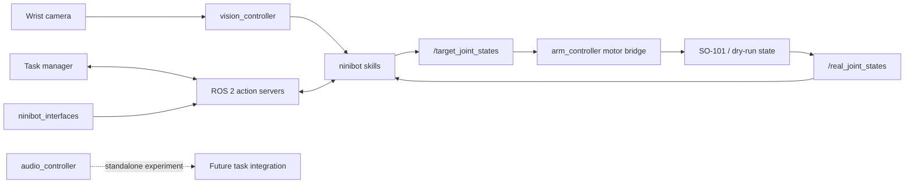

# Software architecture

Ninibot separates reusable robot capabilities from application-level task
orchestration. The controller, perception, audio, and interface packages do not
depend on the top-level application. The `ninibot` package composes them into
observable skills and end-to-end demonstrations.



The dotted audio path represents future integration; the current water-flow
monitor is a standalone experimental subsystem.

## ROS 2 packages

```text
src/
  arm_controller/
  audio_controller/
  vision_controller/
  ninibot_interfaces/
  ninibot/
```

## `arm_controller`

Owns the robot model, kinematics, joint-state plumbing, and physical motor
bridge.

```text
arm_controller/
  kinematics/
    cylindrical.py
    point_ik.py
    grippertip_ik_solver.py
    grippertip_ik_service.py
  motor/
    motor_driver.py
    target_to_rviz.py
    read_arm.py
  debug/
    gripper_pose_debug.py
    keyboard_point.py
    static_joints.py
urdf/
  so101.urdf
  assets/
launch/
rviz/
```

Its console scripts point directly to the modules above; duplicate root-level
wrappers are not retained.

## `vision_controller`

Provides reusable perception primitives without owning task state machines or
demo orchestration.

```text
vision_controller/
  aruco_detection.py
  aruco_tf.py
  hsv_detector.py
  yolo_detector.py
  hybrid_detector.py
assets/
  aruco/
    marker PNG/PDF print assets
    generate_aruco.py
    pngs_to_letter_pdf.py
```

ArUco print assets are installed under
`share/vision_controller/assets/aruco/`.

The three cup-detector options represent different engineering trade-offs:

- HSV provides a lightweight, model-free baseline for a controlled workcell.
- YOLO provides semantic cup detection using user-supplied weights.
- Hybrid mode uses YOLO as a region gate and HSV for the centering signal.

## `audio_controller`

Contains the experimental water-flow monitoring subsystem:

```text
audio_controller/
  audio_input.py
  audio_features.py
  water_flow_detector.py
  water_flow_monitor_node.py
config/
  water_flow.yaml
launch/
  water_flow_debug.launch.py
```

It is intentionally isolated from the production task manager until its
behavior is validated as part of the full workcell.

## `ninibot_interfaces`

Contains ROS interface definitions only, keeping message schemas separate from
runtime behavior:

```text
action/
  GraspCup.action
  MoveCup.action
srv/
  SolveGrippertipIk.srv
```

## `ninibot`

The application package composes the lower-level packages into manipulation
skills, actions, orchestration, data collection, and experimental learning
tools.

```text
ninibot/
  skills/
    grasp_cup/
    move_cup/
    press_button/
    grasp_cup_node.py
    move_cup_node.py
    press_button_node.py
    random_place_cup_node.py
    shutdown_on_task_status.py
  actions/
    grasp_cup_action_server.py
    move_cup_action_server.py
  orchestration/
    full_demo_manager.py
    episode_loop_node.py
    fine_align_episode_collector.py
  logging/
    episode_logger.py
  policies/
    policy_preview.py
    fine_align_policy_gate.py
  trajectories/
    prep_trajectory.py
    record_prep_trajectory.py
    process_prep_trajectory.py
    preview_prep_trajectory.py
  task_params.py
launch/
  demos/
  debug/
  learning/
config/
  aruco_follower.yaml
  motor.yaml
rviz/
```

Console scripts resolve directly to `ninibot.*` modules. Launch files are
installed recursively under `share/ninibot/launch/`, so the user-facing entry
point remains:

```bash
ros2 launch ninibot <launch-file>.launch.py
```

## Design choices demonstrated by the repository

- **Skill isolation:** grasp, transfer, and button press can be launched and
  observed independently.
- **Explicit orchestration:** ROS 2 actions and status topics expose progress
  and failure states rather than hiding the workflow inside one process.
- **Hardware abstraction:** the same target-joint contract feeds the real motor
  bridge and dry-run visualization.
- **Multiple perception backends:** HSV, YOLO, and hybrid detection can be
  selected without rewriting the grasp state machine.
- **Safe experimentation boundaries:** learned-policy and audio experiments are
  separated from the main hardware demo.
- **Traceable motion development:** raw teaching, processed templates,
  diagnostics, and RViz comparison artifacts form a reproducible trajectory
  workflow.
